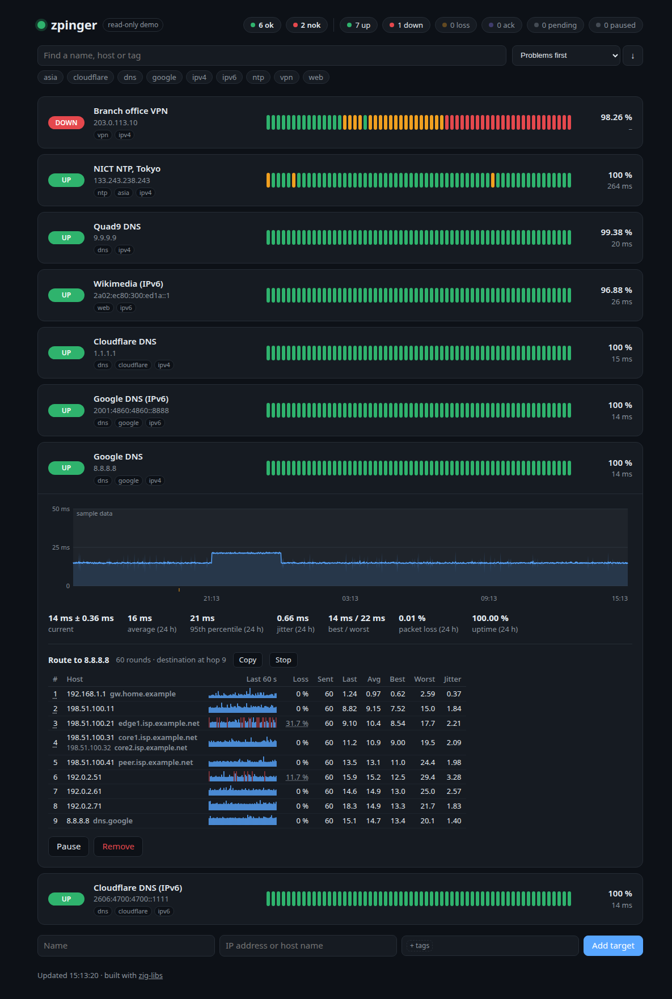

# zpinger

A small ping monitor built on [zig-libs](https://github.com/zaxified/zig-libs): a daemon that pings a
handful of targets once a minute and serves a web page with the last 24 hours.



<sub>Sample data: one target paused, one acknowledged, one row expanded.</sub>

- one row per target with its status, a strip of recent cycles (green: all
  replies, orange: some lost, red: all lost), 24-hour uptime and current latency;
- click a row for the 24-hour latency chart (median per cycle, a band of ± the
  cycle's jitter) with packet loss underneath, and the 24-hour average, 95th
  percentile, jitter, best/worst latency, loss and uptime;
- **edit in place**: the ✎ next to a target's name renames it or moves it to
  another host (the history stays; the status starts over), the one next to
  its tags opens a tag picker like GitHub's label picker, which the add form
  uses too. Both editors work alike: Enter or a click outside saves what
  changed, Esc drops it. An IP address ticks the `ipv4` or `ipv6` tag of a
  new target, and moving a target between the two swaps it;
- **status pills** that count and filter: `ok` and `nok` (needs attention:
  DOWN, losing probes now, or a problem in the last hour; see below), then the
  status now (`up`, `down`, `loss`, `ack`, `pending`, `paused`), all shown
  even at 0. A click shows only that group, several show any of them; they
  count what the tags and the search leave;
- **tags** on targets (a site, a customer, a service): click tags to show only the targets that have all of
  them, **find** by name, host or tag, and **order** the list by name, by the
  packet loss, jitter, average or worst latency of the last hour or 24 hours,
  or problems first (below), either way round. The view lives in the URL
  fragment (`#tags=dns,ipv6&q=google&sort=loss1h`), so a filtered view can be
  bookmarked or sent; the summary at the top still counts every target;
- add, remove and **pause** targets; **acknowledge** a DOWN target the way
  Nagios does: it shows ACK instead of DOWN until 5 cycles in a row are not DOWN
  again, so the next outage is reported;
- **live trace** in the detail (like mtr): the path to the target hop by hop,
  one probe to every hop each second, with loss, last/average/best/worst
  latency, jitter and a sparkline of the last minute per hop; no root
  needed ([Live trace](#live-trace));
- `--read-only` for a public demo: the server refuses every change (HTTP 403);
  the page still shows every control, and using one says it is a demo; every
  control explains itself on hover;
- `--demo` (read-only too) fills the 24 hours with sample data that shows
  what problems look like ([Sample data](#sample-data-for-a-demo)); the last
  hour stays real.

Writable is the default: you run it for yourself, on loopback. The public
demo is the same package with one setting changed ([Deploying](#deploying)).

It started as zig-fping's example application (`fping-watch`, up to 1.0.0)
and is kept small enough to read in one sitting:
`src/monitor.zig` (targets, probing, history, persistence), `src/main.zig`
(HTTP server and API), `src/web/` (the page; no framework and no build step,
embedded into the binary). Nothing beyond Zig's standard library and
zig-libs (`icmp`). It ships as a Debian package with a sandboxed systemd service
([Deploying](#deploying)).

## Build and run

Needs Zig 0.17.0 (`.zigversion`). zig-libs is a package dependency pinned
to a commit in `build.zig.zon`; build against a local checkout with
`zig build --fork=../zig-libs`:

```sh
zig build                     # ReleaseSafe by default
./zig-out/bin/zpinger --targets targets.json --history history.json
# open http://127.0.0.1:8080
```

| option | default | |
|---|---|---|
| `--listen ADDR:PORT` | `127.0.0.1:8080` | web server address |
| `--targets FILE` | `targets.json` | target list; rewritten on every change; a writable instance without it starts empty |
| `--history FILE` | (memory only) | the 24-hour history, saved after every cycle; an unreadable one is moved to `FILE.bad` |
| `--read-only` | off | refuse every change |
| `--demo` | off | `--read-only`, and history older than the last hour is sample data, see [below](#sample-data-for-a-demo) |
| `--allow-host NAME` | | a writable instance also answers to this host name (repeatable), see below |
| `--cycle SECONDS` | `60` | seconds between cycles (the tests use 5) |
| `--trace-max N` | `4` | live traces running at once, 0 turns them off ([Live trace](#live-trace)) |
| `--trace-names on\|off` | `on` | reverse-DNS names of the trace hops |
| `--trace-idle SECONDS` | `600`, read-only `60` | stop a live trace nobody watched this long (a background tab does not poll) |
| `--trace-age SECONDS` | `3600`, read-only `600` | stop every live trace this long after it started |
| `--trust-proxy on\|off` | `on` | for a request from a loopback peer (your reverse proxy), the viewer of a live trace is the last `X-Forwarded-For` address ([Live trace](#live-trace)) |
| `--version` | | print the version and exit |

Pinging needs ICMP sockets: either unprivileged ones
(`sysctl net.ipv4.ping_group_range` covering your group, the default on most
distributions) or `CAP_NET_RAW`.

Files are written through a temporary file that is synced to disk before it
replaces the old one, so a crash or power loss never leaves a truncated list
or history.

`targets.json` needs only names and hosts; `tags` are optional, and ids,
`paused` and `acked` are added when the daemon saves it:

```json
{ "targets": [
  { "name": "Cloudflare DNS", "host": "1.1.1.1", "tags": ["dns", "ipv4"] },
  { "name": "Wikipedia", "host": "wikipedia.org" }
] }
```

### Problems first

The default order, the most urgent on top:

1. DOWN (not acknowledged);
2. LOSS: the last cycle lost some probes;
3. a problem in the last hour: 1 % packet loss or 10 ms of jitter on
   average, or more (one lost probe in an hour is not a problem);
4. such a problem in the last 24 hours;
5. ACK: an acknowledged outage, known and so below the unknown ones;
6. the rest, then PENDING, then PAUSED.

Within a tier, more packet loss and then more jitter go first, the last hour
before the last 24 hours. The first three tiers are the `nok` pill; tiers
4 and 6 (the rest that has been probed) are `ok`.

## Live trace

"Trace route" in a target's detail shows the path to it as mtr does: every
second one ICMP probe goes to each hop (TTL 1, 2, …, up to the destination,
or 30 hops while it has not answered), 20 ms apart, and each hop keeps its
loss and its last, average, best and worst round-trip time and jitter, plus
the last minute as a sparkline. Loss at one hop that the hops after it do
not show is that router limiting its ICMP answers, not loss on the path:
the page shows it grey, with the path's own loss in its tooltip, and keeps
red for loss that carries on to the end.

All traces of one address family run together, as members of one zig-libs
`traceroute.MtrSet` on one socket. Where their paths cross the same routers
(your gateway, your ISP), each such hop gets one probe a second, not one per
trace, and every trace shows that answer (a dotted hop number). Routers
limit their ICMP answers per source, often to about one a second, so
without this every extra trace would make the shared hops look lossier. A
hop is shared only once both traces have seen the same router there a few
times in a row (or one of them nothing at all, with agreeing routers after
it), and each trace probes its whole path itself every 30 seconds, so a
path that changes stops sharing. It runs on the same unprivileged ping socket as the probing (zig-libs
`traceroute`, which reads the routers' answers from the socket's error
queue), so it needs no capability either. Hops are named by reverse DNS
(PTR, through the system resolver, one lookup at a time beside the trace so
a slow resolver never delays a round); `--trace-names off` shows only the
addresses.

A trace measures and changes nothing, so a read-only demo offers it too;
the server bounds it, not the page:

- **one trace per host**, shared by every viewer of every target with that
  host: more viewers never send more probes, they read the same numbers;
- at most `--trace-max` at once (default 4, `0` turns traces off), and at
  most 10 new ones a minute;
- **at most 2 per viewer.** A viewer is a client address, an IPv6 one by
  its /64 (what one subscriber gets). Behind a reverse proxy every request
  comes from loopback, so for a loopback peer the viewer is the last
  `X-Forwarded-For` entry, the one the proxy added (`--trust-proxy off`
  ignores it); a peer that is not on loopback cannot have the header
  believed;
- a trace stops when no viewer polled it for `--trace-idle` (10 minutes on
  a writable instance, your own, so a trace survives switching away; 60 s on
  a read-only one, which is public), and after `--trace-age` in any case
  (1 hour, read-only 10 minutes). Stop (or closing the row) ends only that
  viewer's watching; the trace goes on while someone else watches it.

The page polls an open trace every second and not at all in a hidden tab.
Copy puts the whole table on the clipboard as text (like `mtr --report`); a
click on an address copies just that address. While you select text in the
table it stops refreshing, so a selection is not lost.

## How a cycle works

Every cycle (aligned to the wall clock) takes a copy of the active targets,
resolves names, and pings all of them in **one** `Pinger` round in `.count`
mode: 5 echo requests per target, 1 s apart per target, 20 ms apart globally,
with a random start offset of up to 500 ms per target. That is the library's
pacing at work: the probes are spread out, never burst into the network. The
results are recorded under a lock: probes sent, replies, the median
round-trip time and the jitter (the mean difference between consecutive
replies' round-trip times, as ping tools report it). The web UI therefore never waits for a cycle.

History is a ring of 1440 slots per target, indexed by cycle number, so a gap
(daemon stopped, target paused) needs no bookkeeping: a slot whose timestamp is
not the expected one is shown as "no data".

## API

| | |
|---|---|
| `GET /api/state` | everything the page shows: per target status, flags, tags and the 24 h series `rtt` (ms, median), `jitter` (ms, `null` with fewer than two replies) and `loss` (%), one entry per cycle, oldest first, `null` = no data; carries an ETag, `If-None-Match` gets `304` until the state changes |
| `POST /api/targets` | add: `{"name": "...", "host": "...", "tags": ["..."]}` (`tags` optional) |
| `POST /api/targets/ID/tags` | replace the tags: `{"tags": ["dns", "ipv6"]}`; at most 8, each 1-32 characters without spaces or commas, stored lowercase without duplicates |
| `PATCH /api/targets/ID` | rename, move and/or retag: `{"name": "...", "host": "...", "tags": [...]}` (any may be left out; all or nothing); a new host keeps the history, the status starts over as PENDING and an acknowledgement is dropped |
| `DELETE /api/targets/ID` | remove |
| `POST /api/targets/ID/pause`, `/resume` | stop and resume probing |
| `POST /api/targets/ID/ack`, `/unack` | acknowledge a DOWN target, or withdraw the acknowledgement |
| `POST /api/targets/ID/trace` | start a live trace of the target's host, or join the running one; `202`; `429` when this viewer watches 2 traces already or 10 traces started in the last minute; `503` when `--trace-max` traces run; `403` when traces are off |
| `GET /api/targets/ID/trace` | the trace: `state`, `reason`, `rounds`, `reached`, and per hop `ttl`, `hosts` (latest first), `names` (reverse DNS of `hosts[i]`, `null` = none or not yet), `sent`, `recv`, `loss` (‰), `last`/`avg`/`best`/`worst`/`jitter` (µs, `null` = none), `code` (Destination Unreachable), `shared` (the last answer came from a probe shared with other traces), `spark` (the last 60 rounds, µs or `null` = lost), `max_age` and `idle` (the limits, seconds); polling is watching: it keeps the trace running and counts against the viewer's 2 (`429` over that); `404` when none runs |
| `DELETE /api/targets/ID/trace` | stop watching it; the trace stops when its last viewer has |
| `GET /healthz` | `200 {"ok":true,"read_only":...,"demo":...}` while cycles keep finishing (at most 3 cycles apart) and the ICMP socket opens; `503` otherwise. Unreachable targets do not count: they are what is being monitored |

Changes must be sent as `application/json`: a cross-site HTML form cannot do
that without a CORS preflight, which the server never approves, so a page on
another site cannot change the targets behind your back.

## Scope

Not there yet; know them before you expose it:

- **No authentication.** Without `--read-only`, anyone who reaches the port can
  change the targets. The default address is loopback; the public instance runs
  read-only.
- **Names resolve 16 at a time**, each lookup bounded (2 s per attempt, 2
  attempts, A and AAAA): with a dead DNS server a cycle takes some 10 s
  longer, not minutes; numeric addresses never wait. A name that does not
  resolve shows its target DOWN ("name does not resolve").
- **No TLS.** HTTP/1.1 with keep-alive, each connection on its own thread. A
  reverse proxy in front provides TLS, and the host's protection (CrowdSec,
  fail2ban) per-client request limits.
- **At most 64 targets**, one address per name (the preferred one, in
  getaddrinfo's RFC 6724 order).
- History is saved as JSON after every cycle (about 400 KB for 10 targets).

## Many viewers, and the open internet

Viewers only read: probing runs on its own schedule, however many people
have the page open. The one exception is a live trace, which a viewer
starts, but only to a listed target and within the server's bounds
([Live trace](#live-trace)).

- **One serialization per change.** The state JSON is built once per cycle
  (or target change) and served to every viewer from a cache. The page polls
  every 15 s with `If-None-Match`, so most polls are a body-less `304`; a
  background tab does not poll at all. Measured with 64 targets (a 1.1 MB
  state): 200 concurrent clients fetching it for 10 s, 10 660 full
  responses, 99 threads, 34 MB RSS; idle 11 MB.
- **Bounded connections.** At most 256 at once and 16 from one client
  address (an IPv6 /64); more are closed unanswered. A reverse proxy on
  loopback carries every client on one address, so only the 256 apply to it;
  a proxy on another address (a container bridge, another host) counts as
  one client, and its X-Forwarded-For is not trusted either.
  A request must arrive whole within 10 s of its first byte, a connection
  that sends nothing (or nothing more) is closed after 10 s, and a response
  must be read within 30 s, so a client that never finishes cannot hold a
  thread for longer (250 such connections: 84 MB, all closed on time). A
  flood of them still fills the slots while it lasts; the proxy, which waits
  for a complete request before it connects here, and per-client limits in
  front of it are the answer to that.
- **Nothing to change, nothing to read.** `--read-only` refuses every write
  in the server, not just in the page; the routes are a fixed list (no file
  serving, no path handling); every string reaches the page through
  `textContent`, under a CSP without inline script.

Without `--read-only`, anyone who reaches the server can make it ping
addresses of their choice, including ones on your internal network, and read
which ones answer. Never expose a writable instance.

Loopback alone does not keep web pages out: a page on another site can point
its own host name at 127.0.0.1 (DNS rebinding) and then talk to the server
as its own origin, past the JSON content type check. So a writable instance
answers only when the `Host` header is an IP address, `localhost`, or a
name given with `--allow-host` (behind your own authenticating proxy, say);
anything else gets `421`. A read-only instance answers to any name: it
changes nothing and shows only what it publishes.

Everything in `targets.json` (names *and* host addresses) is public on a
read-only instance; list only targets you are happy to show.

The state is about 15 KB per target, a long run of small numbers that
compresses well: the server sends it gzip-compressed (about a fifth of the
size) to every client that accepts gzip, compressed once per change, not per
request. Enable compression in the proxy (`encode` below) for the page itself.

## Security log

Everything goes to stderr, under systemd into the journal with its priority
(`journalctl -u zpinger -p warning` shows the refusals). Besides the plain
messages (start-up errors, a failed write), anything worth knowing about
who did what is an **event**: one line in a fixed shape, for people and for
log parsers such as CrowdSec ([deploy/crowdsec/](deploy/crowdsec/)).

```
event=http client=198.51.100.7 peer=127.0.0.1 status=429 reason=trace_rate method="POST" path="/api/targets/3/trace" ms=0 bytes=86 ua="Mozilla/5.0 ..."
```

- `client` is who the line is about: the socket peer, or behind a reverse
  proxy on loopback (`--trust-proxy`) the address it forwarded, in which case
  `peer=` follows with the proxy's. A line without `peer` came straight from
  the client.
- Text a client chose (`method`, `path`, `ua`, `host`, a name) is quoted,
  `"` and `\` are escaped with a backslash, every byte outside printable
  ASCII is written `\xNN`, and a value over 200 bytes is cut and ends in
  `...`. A request cannot forge a line or write bytes a parser chokes on.
- What a client can trigger is rate-limited per client (an IPv6 /64: a
  burst of 20, then 2 lines a second) and in total, in classes with budgets
  of their own (refusals and traces 500 then 50 a second, connection events
  the same, answered requests 1000 then 100, changes on a writable instance
  200 then 10): a flood neither fills the journal, nor buries other
  clients' lines, nor one kind of line another. A line is cut at 4 KiB,
  marked ` ...`; `status` and `reason` come first, so no request can push
  them out. No thread waits for the journal: lines go through a 64 KiB
  queue, and when the journal falls that far behind, lines are dropped
  (the server keeps accepting). What was dropped is reported
  every 10 s as `event=log action=dropped class=... count=N`.

| Event | When | Keys |
|---|---|---|
| `start` | the daemon starts | `version listen targets mode trust_proxy allow_host trace_max access_log dns_stale` |
| `conn action=refused` | a connection closed at accept, unanswered | `reason`: `total_cap` (256 open), `per_ip_cap` (16 from one client), `store_full` (too many clients tracked at once) |
| `conn action=closed` | a timeout cut a connection off, or it ended without a single request | `reason`: `timeout` (a slowloris or a slow reader held it to a 10 s deadline), `no_request` (closed by the client: a port scan, TLS on the plain-HTTP port), `idle` (a kept-alive connection no next request came on: browsers do that; `debug` level); `requests ms`, with a timeout `phase` (`no_request head body write response`) |
| `http` | a request, with `--access-log refused` (the default) only those answered 400 or above, with `all` every one | `status reason method path ms bytes ua` (in this order), `host` (with `host_not_allowed`), `xff_ignored` (an X-Forwarded-For from a peer that is not a trusted proxy) |
| `http reason=bad_request_head` | refused before it was read whole: a malformed head (400), too large (431, 414), a body over 4 KiB (413; a chunked one once its reading crosses the cap) | `status`; only the peer is known |
| `audit` | a change on a writable instance | `action` (`add edit remove tags pause resume ack unack`), `target`, `name`, `host`, `host_was`, `tags` (a count) |
| `trace` | a live trace asked for, left, or ended | `action`: `start` (or join), `stop`, `end` (no client, `reason`: `idle max_age stopped unresolved no_socket failed`); `target host` |
| `dns` | a target's name stops resolving or resolves again | `action`: `stale` (no answer from DNS, the last address is probed), `failed` (no address), `recovered`, `moved` (`from addr`); `target host error` |
| `log action=dropped` | the rate limits or a full queue dropped lines | `class count` |

`reason` on `http` lines says why a request was refused:

| `reason` | Status | Meaning |
|---|---|---|
| `host_not_allowed` | 421 | a writable instance asked for under a name it does not answer to: DNS rebinding, or a scanner |
| `read_only` | 403 | a change sent to a read-only instance |
| `not_json` | 415 | a change without the JSON content type (what a cross-site form sends) |
| `bad_json`, `invalid_name`, `invalid_host`, `invalid_tags` | 400 | a change that does not parse or validate |
| `not_found`, `no_such_target`, `no_trace` | 404 | an unknown path (a scanner's signature), target or trace |
| `bad_method` | 405 | a method the route does not take |
| `too_many_targets`, `not_down` | 409 | the target list is full; an acknowledgement of a target that is not DOWN |
| `trace_viewer_limit`, `trace_rate` | 429 | the client watches 2 traces already; 10 traces started in the last minute |
| `trace_cap`, `trace_disabled` | 503, 403 | `--trace-max` traces running; traces are off |
| `handler_failed`, `server_failed` | 500, 503 | a fault on the server's side (logged as errors) |

`--log-level warn` keeps the refusals and drops the rest (starts, audits,
traces); `--access-log off` drops the `http` lines too.

## Deploying

Every zpinger release carries `zpinger_<version>_amd64.deb` and
`_arm64.deb` (built by `package.sh`; checksums in `SHA256SUMS`). The binary is
static; the package needs only `init-system-helpers`, which every Debian or
Ubuntu with systemd has.

```sh
sha256sum -c --ignore-missing SHA256SUMS
apt install ./zpinger_1.0.0_amd64.deb
```

That installs, enables and starts `zpinger.service` on `127.0.0.1:8080`,
writable and with no targets yet: open the page and add them (on a server,
through a tunnel: `ssh -L 8080:127.0.0.1:8080 server`).

| path | |
|---|---|
| `/usr/bin/zpinger` | the binary |
| `/usr/lib/systemd/system/zpinger.service` | the service ([deploy/zpinger.service](deploy/zpinger.service)) |
| `/etc/zpinger/env` | optional settings, below |
| `/var/lib/zpinger/targets.json` | the target list the page edits (systemd `StateDirectory`) |
| `/var/lib/zpinger/history.json` | the history |
| `/usr/share/zpinger/targets.json` | a sample list: public resolvers and sites, IPv4 and IPv6 |
| `/usr/share/zpinger/Caddyfile` | a Caddy site to start from ([deploy/Caddyfile](deploy/Caddyfile)) |
| `/usr/share/zpinger/crowdsec/` | CrowdSec acquisition, parser and scenarios for the security log ([deploy/crowdsec/](deploy/crowdsec/README.md)) |

Settings go in `/etc/zpinger/env` (then `systemctl restart zpinger`):

| variable | default | |
|---|---|---|
| `ZPINGER_LISTEN` | `127.0.0.1:8080` | the web server address |
| `ZPINGER_TARGETS` | `/var/lib/zpinger/targets.json` | the target list; a read-only instance points it at a file you manage, such as `/etc/zpinger/targets.json` |
| `ZPINGER_OPTS` | (none) | further options: `--read-only`, `--allow-host NAME` |

Upgrades restart the service (and leave it alone if you disabled it).
`apt remove` keeps the settings, the list and the history; `apt purge`
deletes them.

zpinger was called `fping-watch` up to 1.0.0. The package conflicts with the
old `fping-watch` package (same default port); its `/etc/fping-watch/env`
and `/var/lib/fping-watch/` are not carried over (variables are now
`ZPINGER_*`).

The service runs as a throwaway user (`DynamicUser`) that can write only its
state directory, with no capabilities at all and under a strict sandbox:
seccomp `@system-service`, IPv4/IPv6 sockets only, a private user namespace,
no writable-executable memory, read-only system, `TasksMax` and `MemoryMax`
(`systemd-analyze security zpinger`: 1.3, "OK").

ICMP goes through unprivileged ping sockets, which
`net.ipv4.ping_group_range` must allow for the service's group. systemd's
own defaults (`/usr/lib/sysctl.d/50-default.conf`, on Debian and Ubuntu)
allow every group; `sysctl net.ipv4.ping_group_range` shows what a host has.
Where they do not, `/healthz` reports `"probing_ok":false` and the journal
`probing failed: PermissionDenied`: allow ping sockets in `/etc/sysctl.d/`,
or give the service raw sockets instead (`systemctl edit zpinger`):

```ini
[Service]
AmbientCapabilities=CAP_NET_RAW
CapabilityBoundingSet=CAP_NET_RAW
# A capability inside a private user namespace does not reach the host's network.
PrivateUsers=no
```

### A public read-only demo

With Ansible: the settings first, then the package, so the service never
runs writable; the health check then insists on read-only.

```yaml
- name: zpinger settings directory
  ansible.builtin.file: { path: /etc/zpinger, state: directory, mode: "0755" }
- name: zpinger settings
  ansible.builtin.copy:
    dest: /etc/zpinger/env
    mode: "0644"
    content: |
      ZPINGER_LISTEN=127.0.0.1:8080
      ZPINGER_TARGETS=/etc/zpinger/targets.json
      ZPINGER_OPTS=--demo
  notify: restart zpinger
- name: zpinger targets
  ansible.builtin.copy: { src: targets.json, dest: /etc/zpinger/targets.json, mode: "0644" }
  notify: restart zpinger
- name: zpinger package
  ansible.builtin.get_url:
    url: https://github.com/zaxified/zpinger/releases/download/vX.Y.Z/zpinger_1.0.0_amd64.deb
    dest: /var/cache/zpinger_1.0.0_amd64.deb
    # Pinned from the release's SHA256SUMS: a checksum fetched along with
    # the package would prove nothing.
    checksum: "sha256:<the hash from SHA256SUMS>"
- name: zpinger installed
  ansible.builtin.apt: { deb: /var/cache/zpinger_1.0.0_amd64.deb }
- name: zpinger is healthy and read-only
  ansible.builtin.uri: { url: "http://127.0.0.1:8080/healthz" }
  register: health
  until: health.status == 200 and health.json.read_only
  retries: 10
  delay: 2
```

Then publish it through the reverse proxy, compressed:

```caddyfile
ping.example.org {
	encode zstd gzip
	reverse_proxy 127.0.0.1:8080
}
```

Caddy has no per-client rate limits without a plugin; on the open internet
let the host's protection (CrowdSec, fail2ban) watch the proxy's log. The
sample list pings IPv6 addresses too: on a host without IPv6 they stay DOWN,
so leave them out there.

### Sample data for a demo

A new demo has no history, and a healthy network has nothing to show. With
`--demo`, after the first cycle and then at every full hour, everything older
than the last full hour of real probing (or than the start of the daemon,
whichever is later) is replaced with sample data; the page shades it and
marks it "sample data", tooltips included. Only targets with a `"demo"`
scenario get it:

```json
{ "id": 1, "name": "Cloudflare DNS", "host": "1.1.1.1", "demo": "evening_congestion" }
```

| scenario | what it shows |
|---|---|
| `steady` | nothing: small noise, a rare spike |
| `evening_congestion` | a congested uplink 18-22 UTC: latency and jitter climb, a little loss |
| `route_change` | a latency plateau for three hours, 18 to 15 hours ago |
| `flapping` | bursts of partial loss all day, an 8-minute outage 6 hours ago |
| `outage` | 20 minutes of rising latency, jitter and loss, then 45 minutes DOWN, recovered 3 hours ago |
| `down` | the same warning signs, then DOWN from 25 minutes before the live hour: for a target that never answers |
| `bufferbloat` | a nightly backup 01:00-02:30 UTC: a sawtooth of queueing delay |
| `long_haul` | a distant host: more jitter, busier 10-14 UTC |

The sample data is scaled to the target's real median latency, so it joins
the live hour. Time-of-day scenarios stay where they are; the others are
placed relative to the live hour, so they never fall into it, and move on
with it every hour. The sample data is never written to the history file. Live probing stays real, so choose
targets that answer. The package ships a list of public IPv4 and IPv6
targets with one scenario each, `/usr/share/zpinger/demo-targets.json`
(`ZPINGER_TARGETS` can point at it directly); its DOWN target is in
203.0.113.0/24, a range reserved for documentation (RFC 5737) that never
answers.

## About page

For a page that lists several demos, the package carries a description of
this one in `/usr/share/zpinger/about/` (`zig build about` writes the same
into `zig-out/about/`), generated from [deploy/about.json](deploy/about.json):

| file | |
|---|---|
| `about-card.html` | an HTML fragment to include: one `<article class="demo" id="demo-zpinger">`, no styles, no scripts; class names (`demo-title`, `demo-tagline`, `demo-screenshot`, `demo-summary`, `demo-features`, `demo-facts`, `demo-source`) for the hub to style, schema.org `SoftwareApplication` microdata, `data-version` |
| `about.html` | the same card as a standalone page (light and dark) |
| `about.json` | the same data plus `version`, for templating |
| `screenshot.png` | referenced by both pages relatively, keep it next to them |

None of them links to the demo itself: only the hub knows its URL. With
Ansible, after the package is installed on the same host:

```yaml
- name: zpinger about card
  ansible.builtin.copy:
    src: /usr/share/zpinger/about/
    dest: "{{ demo_hub_root }}/zpinger/"
    remote_src: true
```

## Tests

```sh
zig build test     # unit tests: status, acknowledgement, history ring, cache, health, persistence, Host guard, validation, escaping
sh smoke.sh        # end to end: loopback targets, API, ETag, health, Host guard, deadline, read-only mode
./package.sh       # the .deb packages; smoke-tests the packaged binary first
```

`smoke.sh` runs itself in an isolated network namespace through
`scripts/netns-run`; `package.sh` resolves Zig through `scripts/zig-env.sh`.
`scripts/test.sh` runs all of it (plus `zig fmt --check`) and is what CI
runs; a `v*` tag runs it too and publishes the packages as a GitHub release.

## License

MIT ([LICENSE](LICENSE)). zig-libs, linked into the binary, is MIT too; the
package's `copyright` file carries both notices.
